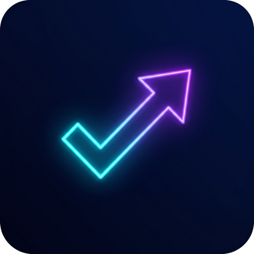

# ⚡ XFlowAI

<p align="center">
  
</p>

<h3 align="center">Oyunlaştırılmış Akıllı Görev Yöneticisi & Kişisel Yapay Zeka Koçu</h3>

<p align="center">
  Kişisel üretkenliğini seviye atlat, görevlerini tamamla, rozetler kazan ve kozmik seviyelere ulaş! 🚀
</p>

<p align="center">
  
  
  
  
  
  
  
</p>

---

## 📖 Genel Bakış

**XFlowAI**, klasik yapılacaklar listesi (To-Do) uygulamalarının sıkıcılığını ortadan kaldıran; **RPG oyunlaştırma mekanikleri**, **gelişmiş fütüristik tasarım** ve **Google Gemini Yapay Zeka Koçu** ile donatılmış modern bir üretkenlik platformudur.

Kullanıcılar her tamamladıkları görev için deneyim puanı (**XP**) kazanır, seviye atlar, benzersiz unvanlar ve auralar açar, başarım rozetleri koleksiyonu yapar ve yapay zekanın sağladığı derin araştırma modülleriyle öğrenme süreçlerini hızlandırır.

---

## 🌟 Öne Çıkan Özellikler

### 🎮 1. RPG Tabanlı Oyunlaştırma Mekanikleri
* **Seviye & Deneyim (XP) Eğrisi:** Her görev önceliğine göre dinamik XP kazandırır (Yüksek: 150 XP, Orta: 75 XP, Düşük: 35 XP).
* **7 Efsanevi Kademe (Tier):**
  * 🌱 **Acemi (Lvl 1 - 9):** Temel alışkanlıklar ve görev defteri.
  * 🔥 **Avcı (Lvl 10 - 19):** Alev aurası, parçacık ışıltıları ve hız.
  * ⚡ **Uzman (Lvl 20 - 29):** Elektrik aurası ve şimşek akış durumu.
  * 👑 **Usta (Lvl 30 - 49):** Altın taç çerçevesi ve sarsılmaz disiplin.
  * 💎 **Efsane (Lvl 50 - 74):** Kristal zihin ve kozmik meteor kaymaları.
  * 🌌 **Kozmik (Lvl 75 - 99):** Galaksi çekirdeği ve nebula enerjisi.
  * ☄️ **Ölümsüz (Lvl 100+):** İlahi gökkuşağı aurası ve sonsuz prestij.
* **Seviye Ödül Yol Haritası (Roadmap):** Hangi seviyede hangi görsel özelliklerin ve bonusların açılacağını gösteren interaktif modal.
* **Başarım Rozetleri (Badges):** Toplam 12+ özel rozet (İlk Adım, Kriz Çözücü, Efsanevi Hüküm, Temiz Masa vb.) ve tek tıkla talep edilen rozet ödülleri.
* **Synthesizer Tabanlı Web Audio Sesleri:** 8-bit / arcade havasında saf tarayıcı sentezleyicisi (tamamlama, seviye atlama, rozet alma ve tıklama sesleri).

---

### 🤖 2. Kişisel Yapay Zeka Koçu (Google Gemini 2.0 / 1.5)
* **Kişiselleştirilmiş Görev Önerileri:** Kullanıcının mesleğine (Yazılım, Tasarım, Girişimcilik vb.), çalışma tarzına ve odak saatlerine göre özel görev önerileri.
* **AI Taahhüt Bonusu (+10 XP):** Yapay zekanın önerdiği bir görevi kabul ettiğinizde anında +10 XP kazanır; görevi silerseniz ceza uyarısı alırsınız.
* **İnteraktif AI Sohbeti (AI Chat):**
  * Üretkenlik, odaklanma ve hedef bölme koçu.
  * `[TASK: {...}]` akıllı ayrıştırması sayesinde sohbette üretilen görevler **tek tıkla ana panoya** eklenebilir.
  * Dış alana tıklandığında otomatik kapanan sezgisel sohbet penceresi.
* **Akıllı Araştırma & Not Değerlendirmesi (+25 Bonus XP):**
  * Her görevin alt başlıklarına araştırma notları yazabilme.
  * Yapay zekanın notları analiz edip samimi geri bildirimle birlikte **+15 ile +30 Bonus XP** vermesi.
* **Yüksek Kotalı Model Önceliği & Akıllı Failover:**
  * Günlük 1.500 istek hakkı sunan `gemini-2.0-flash` ve `gemini-1.5-flash` modellerine öncelik verilir.
  * Kota aşımı (429 / Resource Exhausted) veya model arızası durumunda anında yedek modellere otomatik geçiş.
* **Kesintisiz Çevrimdışı AI Modu (Offline Fallback):**
  * Ağ veya API kotası dolduğunda bile sistem durmaz; yerel zeka motoru seviyenize ve mesleğinize uygun kaliteli görev ve koçluk çıktıları üretir.

---

### 🎨 3. Fütüristik & Akıcı Arayüz Deneyimi
* **Karanlık Siber Tema:** Derin `#090a10` zemin, cam (glassmorphism) paneller, neon ışıltılar.
* **Gelişmiş Mikro-Animasyonlar:** `motion` kütüphanesi ile akıcı kart girişleri, sürükleme efektleri ve layout geçişleri.
* **Görsel Kutlamalar:** Parçacık dalgaları (`@tsparticles`), konfeti patlamaları (`canvas-confetti`) ve dinamik yüzen XP etiketleri (Floating XP).
* **Modern Lucide İkonografi:** Emojiler yerine yüksek kaliteli vektör simgeler.

---

### 🛡️ 4. Gizlilik ve Yerel Veri Güvenliği
* **Sunucusuz Mimari (Serverless):** Veritabanı tutulmaz, verileriniz üçüncü taraf sunuculara gönderilmez.
* **Tamamen Yerel:** Tüm görevler, seviyeler ve sohbet geçmişi tarayıcınızın güvenli `localStorage` alanında saklanır.
* **İsteğe Bağlı API Anahtarı:** Kullanıcılar kendi ücretsiz Google AI Studio anahtarlarını güvenle girip dilediklerinde sıfırlayabilirler.

---

## 🛠️ Teknoloji Yığını

| Alan | Teknoloji | Açıklama |
| :--- | :--- | :--- |
| **Framework** | [React 19](https://react.dev/) | En son sürüm React mimarisi ve Hook yapıları |
| **Derleyici / Build** | [Vite 8](https://vite.dev/) + [Rolldown](https://rolldown.rs/) | Ultra hızlı HMR ve gelişmiş vendor chunk optimizasyonu |
| **Stil / Tasarım** | [Tailwind CSS v4](https://tailwindcss.com/) | Modern CSS-first utility motoru |
| **Animasyon** | [Motion (Framer Motion)](https://motion.dev/) | Karmaşık fizik tabanlı arayüz animasyonları |
| **İkonlar** | [Lucide React](https://lucide.dev/) | 1000+ modern ve temiz vektör ikon seti |
| **Yapay Zeka** | [Google Gemini API](https://ai.google.dev/) | Gemini 2.0 Flash & 1.5 Flash LLM entegrasyonu |
| **Parçacık & Efekt** | [tsParticles](https://particles.js.org/) + [canvas-confetti](https://www.kirilv.com/canvas-confetti/) | Seviye atlama kutlamaları ve auralar |
| **Ses Motoru** | Web Audio API | Sıfır harici dosya boyutlu tarayıcı ses sentezleyicisi |
| **Dağıtım (Deploy)** | [Netlify](https://www.netlify.com/) | Global CDN, SPA Routing ve güvenlik başlıkları |

---

## 🚀 Hızlı Başlangıç (Yerel Kurulum)

Projeyi bilgisayarınızda çalıştırmak için aşağıdaki adımları izleyin:

### Gereksinimler
* [Node.js](https://nodejs.org/) (v18 veya üzeri önerilir)
* `npm` veya `pnpm` / `yarn`

### 1. Depoyu Klonlayın
```bash
git clone https://github.com/SelimAyerr/TaskManagerAI.git
cd TaskManagerAI
```

### 2. Bağımlılıkları Yükleyin
```bash
npm install
```

### 3. Çevre Değişkenleri (Opsiyonel)
Canlı dağıtımda veya yerelde varsayılan API anahtarı tanımlamak isterseniz `.env.example` dosyasını kopyalayın:
```bash
cp .env.example .env
```
`.env` dosyasını açıp [Google AI Studio](https://aistudio.google.com/app/apikey) üzerinden aldığınız ücretsiz anahtarı ekleyin:
```env
VITE_GEMINI_API_KEY=AIzaSy...
```
*(Not: Bu adımı atlayıp doğrudan uygulama açıldığında Profil Sihirbazından da anahtarınızı girebilirsiniz.)*

### 4. Geliştirme Sunucusunu Başlatın
```bash
npm run dev
```
Tarayıcınızda `http://localhost:5173` adresine giderek uygulamayı kullanmaya başlayabilirsiniz! 🎉

---

## 🌐 Netlify ile Canlıya Alma (Deployment)

Bu proje Netlify üzerinde tek tıkla çalışacak şekilde optimize edilmiştir (`netlify.toml` ve `public/_redirects` hazır durumdadır).

### Yöntem 1: GitHub Üzerinden Otomatik Dağıtım (Önerilen)
1. Kodlarınızı GitHub deponuza yükleyin (`git push`).
2. [Netlify](https://app.netlify.com/) hesabınıza giriş yapın.
3. **"Add new site" -> "Import an existing project"** seçeneğine tıklayın.
4. GitHub deponuzu seçin.
5. Yapılandırma ayarları otomatik olarak algılanacaktır:
   * **Build command:** `npm run build`
   * **Publish directory:** `dist`
6. *(İsteğe Bağlı)* **Environment Variables** bölümüne giderek `VITE_GEMINI_API_KEY` anahtarınızı ekleyin.
7. **"Deploy Site"** butonuna basın. Birkaç saniye içinde siteniz canlıda! 🚀

### Yöntem 2: Netlify CLI ile Hızlı Dağıtım
```bash
npm run build
npx netlify deploy --prod --dir=dist
```

---

## 🔒 Güvenlik & Optimizasyon Detayları

* **Gelişmiş Güvenlik Başlıkları:** [`netlify.toml`](file:///Users/selim/Desktop/TaskManagerAI/netlify.toml) yapılandırmasında `X-Frame-Options: DENY`, `X-Content-Type-Options: nosniff`, `Referrer-Policy: strict-origin-when-cross-origin` ve `Permissions-Policy` tanımlıdır.
* **Akıllı Kod Bölümleme (Code Splitting):** Vite yapılandırmasında kütüphaneler (`vendor-react`, `vendor-motion`, `vendor-effects`, `vendor-icons`) bağımsız chunk'lara ayrılmıştır. Bu sayede ilk sayfa yükleme süresi minimuma indirilmiştir.
* **Kalıcı Varlık Önbellekleme (Immutable Cache):** Hashed asset'ler için 1 yıllık `max-age=31536000, immutable` önbellek kuralı uygulanırken, `index.html` her zaman güncel kalacak şekilde ayarlanmıştır.
* **SPA Routing Güvencesi:** Sayfa yenilemelerinde veya doğrudan rota erişimlerinde 404 hatası alınmaması için `_redirects` kuralı devrededir.

---

## 📁 Proje Dizin Yapısı

```text
XFlowAI/
├── public/
│   ├── _redirects              # Netlify SPA yönlendirme kuralı
│   ├── brand-icon-*.png        # Çoklu çözünürlük marka ikonları
│   ├── favicon.ico             # Çoklu çerçeve tarayıcı sekme ikonu
│   └── favicon.svg             # Vektörel sekme ikonu
├── src/
│   ├── ai/
│   │   ├── gemini.js           # Gemini API istemcisi, failover & offline koç
│   │   ├── promptBuilder.js    # Kişiselleştirilmiş sistem istemleri
│   │   └── userProfile.js      # Kullanıcı kimlik & alışkanlık hafızası
│   ├── components/
│   │   ├── ai/
│   │   │   ├── AIChat.jsx              # İnteraktif yapay zeka sohbeti
│   │   │   ├── AITaskSuggestions.jsx   # Kişiselleştirilmiş görev kartları
│   │   │   └── ProfileSetupWizard.jsx  # Meslek & hedef belirleme sihirbazı
│   │   ├── BadgeMenu.jsx       # Rozet koleksiyonu & bildirim çekmecesi
│   │   ├── FloatingXP.jsx      # Yüzen XP ve enerji patlama efektleri
│   │   ├── LevelRoadmapModal.jsx # Seviye ve unvan yol haritası
│   │   ├── LevelUpModal.jsx    # Seviye atlama kutlama penceresi
│   │   ├── Navbar.jsx          # Üst navigasyon, seviye barı & ses anahtarı
│   │   ├── PlayerProfile.jsx   # Oyuncu kartı, rozet özeti & istatistikler
│   │   ├── TaskCard.jsx        # Görev kartı, alt başlıklar & araştırma notları
│   │   └── TaskForm.jsx        # Yeni görev ekleme ve düzenleme formu
│   ├── context/
│   │   ├── AIContext.jsx       # Yapay zeka ve öneri state yönetimi
│   │   └── GameContext.jsx     # Seviye, XP, rozet ve ses state yönetimi
│   ├── pages/
│   │   └── Home.jsx            # Ana kontrol paneli ve görev görünümü
│   ├── App.jsx                 # Ana uygulama bileşeni
│   ├── index.css               # Tailwind v4 stilleri & özel parıltılar
│   └── main.jsx                # React başlangıç noktası & Favicon cache-buster
├── .env.example                # Örnek çevre değişkenleri
├── netlify.toml                # Netlify derleme, SPA ve güvenlik başlıkları
├── package.json                # Bağımlılıklar ve npm scriptleri
├── vite.config.js              # Vite 8 & Rolldown chunk optimizasyonu
└── README.md                   # Proje dokümantasyonu
```

---

## 🤝 Katkıda Bulunma

Katkı sağlamak isterseniz çok memnun oluruz!
1. Depoyu Fork'layın (`Fork`).
2. Kendi özellik dalınızı oluşturun (`git checkout -b feature/YeniOzellik`).
3. Değişikliklerinizi commit'leyin (`git commit -m 'feat: Yeni özellik eklendi'`).
4. Dalınıza push yapın (`git push origin feature/YeniOzellik`).
5. Bir **Pull Request (PR)** açın.

---

## 📄 Lisans

Bu proje [MIT Lisansı](LICENSE) kapsamında açık kaynak olarak lisanslanmıştır. Dilediğiniz gibi kullanabilir, değiştirebilir ve geliştirebilirsiniz.

<p align="center">
  Geliştirici için <b>XFlowAI</b> ile üretkenliğin zirvesine ulaşın! ⚡
</p>
